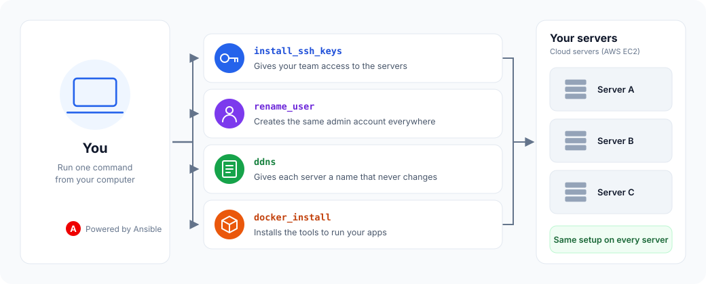
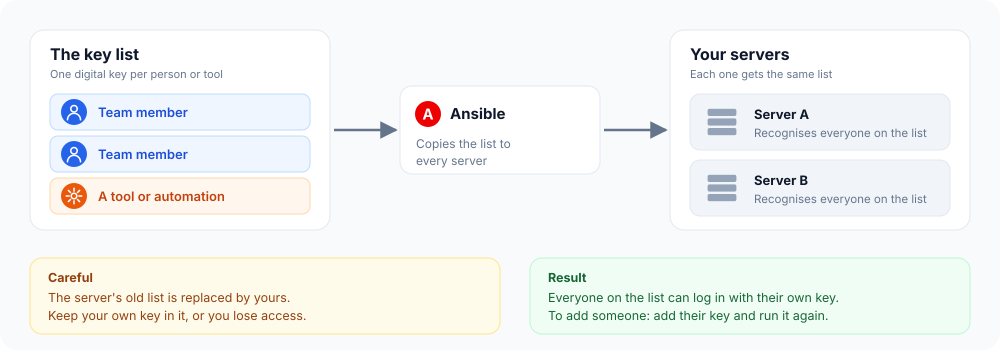
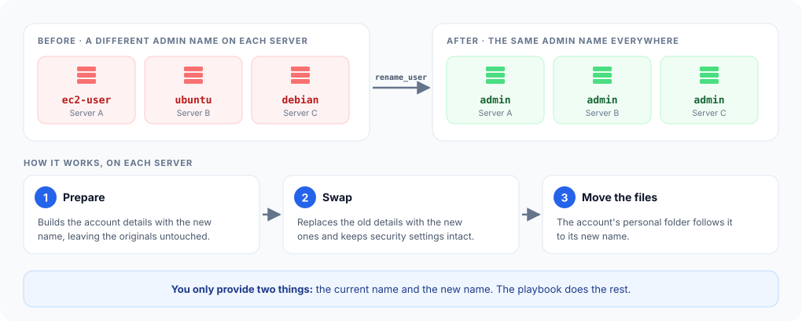
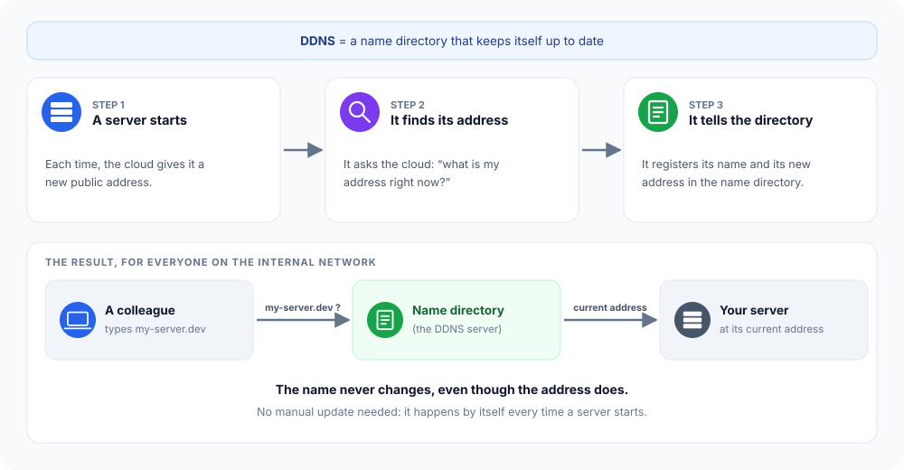
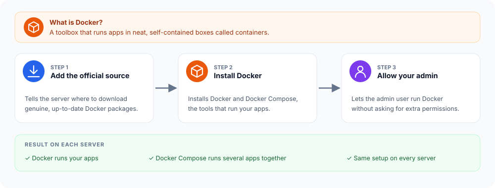

<div align="center">

# Ansible
_EC2 provisioning playbooks_


</div>
  
Ready-to-use Ansible playbooks to set up **any AWS EC2 instance**: give your team SSH access, create a common admin user, get a stable internal name, and install Docker. Each playbook solves one problem and runs the same way on every server.

Originally written during my junior DevOps internship, then made generic so it can be reused on any project.

## Overview



| Playbook | In short | Target |
| :-- | :-- | :-- |
| [`install_ssh_keys`](install_ssh_keys.yml) | Gives your team access to the servers | `servers` |
| [`rename_user`](rename_user.yml) | Creates the same admin account everywhere | `aws ec2` |
| [`ddns`](ddns.yml) | Gives each server a name that never changes | `servers` |
| [`docker_install`](docker_install.yml) | Installs Docker and Docker Compose | `servers` |

## Quick start

```bash
pip install ansible
```

The [inventory](inventory.ini) lists your servers and how to connect to them. Replace the example hosts with your own EC2 instances:

```ini
[servers]
server-1   ansible_host=<public-ip-or-hostname>
server-2   ansible_host=<public-ip-or-hostname>

[servers:vars]
ansible_user=admin
ansible_ssh_private_key_file=~/.ssh/id_rsa.pem
ansible_python_interpreter=/usr/bin/python3
```

> `rename_user` targets the `ec2` group, which has to be declared in the inventory as well.

Every playbook runs the same way. `-l` limits the run to one host (or group); without it, the playbook runs on all of its targets:

```bash
ansible-playbook -i inventory.ini -l server-1 <playbook>.yml
```

---

## `install_ssh_keys`

**In short:** gives your team access to the servers.



Installs the SSH public keys listed in [`files/authorized_keys`](files/authorized_keys) as the `authorized_keys` of the `admin` user on each host. To give someone access, add their public key to that file and run the playbook again.

```bash
ansible-playbook -i inventory.ini -l server-1 install_ssh_keys.yml
```

> **Warning:** the remote `authorized_keys` is **replaced**, not appended to. Keep your own key in the file, or you will lock yourself out.

---

## `rename_user`

**In short:** creates the same admin account on every server.



Renames a Linux user: you give it the current username and the one you want, and it does the rest. This is handy on AWS, where the default user depends on the AMI (`ec2-user`, `admin`, `ubuntu`...). Running it on every instance gives the whole fleet one common admin user, so the inventory and the other playbooks work everywhere without special cases.

Under the hood it edits copies of `/etc/passwd`, `/etc/group`, `/etc/shadow` and the sudoers file, replaces the originals with the right permissions, then moves the home directory.

| Variable | Default | Description |
| :-- | :-- | :-- |
| `old_user` | `random` | Current username, to rename |
| `new_user` | `admin` | New username |
| `ansible_user` | `admin` | User of the SSH connection |

```bash
ansible-playbook -i inventory.ini -l server-1 rename_user.yml \
  -e old_user=ec2-user -e new_user=admin
```

---

## `ddns`

**In short:** gives each server a name that never changes, even though its address does.



The public IP of an EC2 instance changes every time it starts, which breaks classic DNS. This playbook relies on a **private dynamic DNS server** (running on an EC2 instance) that provides internal name resolution. At every boot, each server registers its current public IP there, so `<hostname>.dev` always resolves to the right address: `my-server.dev` leads to the current public IP of `my-server`.

The playbook deploys:

- a [systemd service](files/update-dns.service) that runs once at boot, after the network is up
- a [bash script](templates/update-dns.sh.j2), rendered from a Jinja2 template with the host's name, that reads the public IP from the EC2 metadata service (IMDSv2) and sends the update with `nsupdate`
- the [TSIG key](files/tsig.key) that authorizes the update
- `bind9-dnsutils`, which provides `nsupdate`

Before the first run, set the address of your DDNS server (`DNS_SERVER`) in [`templates/update-dns.sh.j2`](templates/update-dns.sh.j2) and put your TSIG key in [`files/tsig.key`](files/tsig.key).

```bash
ansible-playbook -i inventory.ini -l server-1 ddns.yml
```

---

## `docker_install`

**In short:** installs Docker and Docker Compose.



Docker is needed on every server, so this playbook sets it up from scratch: the official apt repository, Docker Engine (`docker-ce`, `docker-ce-cli`, `containerd.io`) and the `buildx` and `compose` plugins. It then adds the SSH user to the `docker` group, which takes effect at the next SSH login.

It targets Debian hosts.

```bash
ansible-playbook -i inventory.ini -l server-1 docker_install.yml
```

---

## Supporting files

| File | Purpose |
| :-- | :-- |
| [`inventory.ini`](inventory.ini) | Hosts, groups and connection settings |
| [`files/authorized_keys`](files/authorized_keys) | Public SSH keys to deploy |
| [`files/tsig.key`](files/tsig.key) | TSIG key for DNS updates |
| [`files/update-dns.service`](files/update-dns.service) | systemd unit of the DDNS updater |
| [`templates/update-dns.sh.j2`](templates/update-dns.sh.j2) | DDNS update script (Jinja2 template) |

> **Secrets:** never commit a real TSIG key or private key. Encrypt them with [Ansible Vault](https://docs.ansible.com/ansible/latest/vault_guide/index.html) or inject them at runtime.

## Skills demonstrated

- **Ansible**: inventories, variables and `-e` overrides, Jinja2 templates
- **Linux / Debian**: systemd, apt, users, sudoers and file permissions
- **AWS**: EC2 instances, IMDSv2 metadata service
- **DNS**: dynamic updates with `nsupdate` and TSIG
- **Containers**: Docker Engine and Compose provisioning
